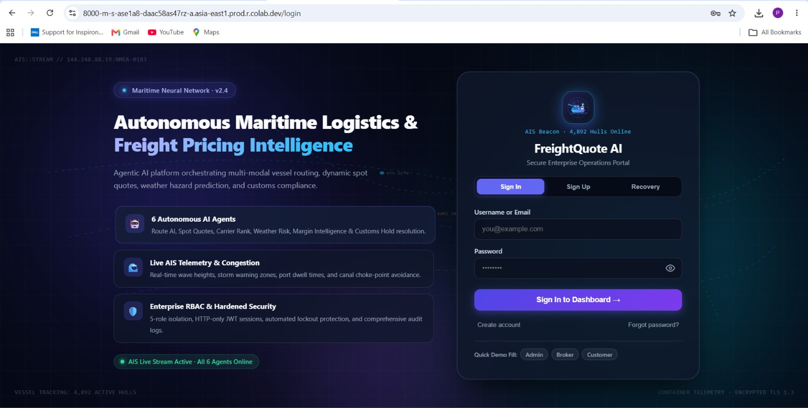
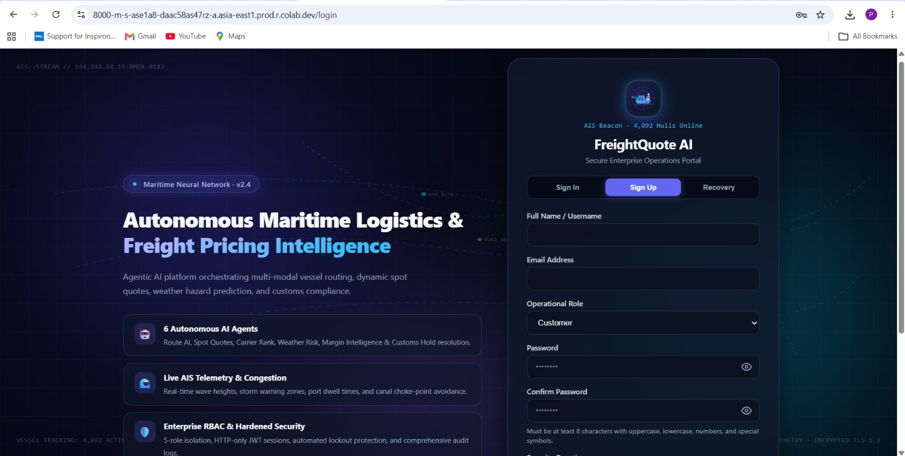
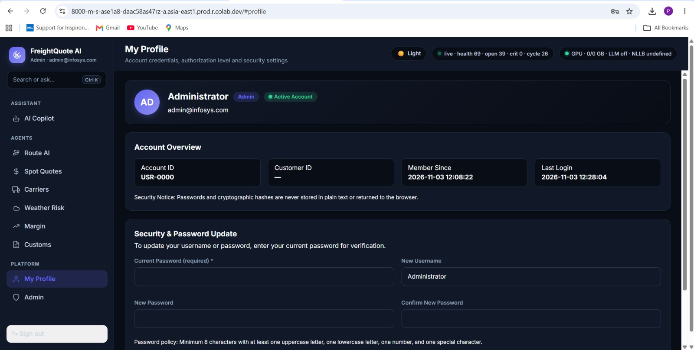
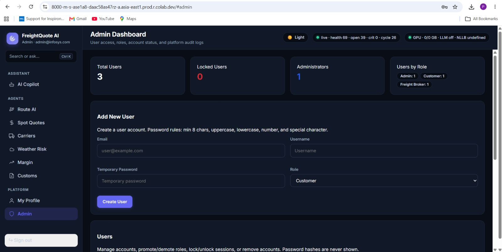
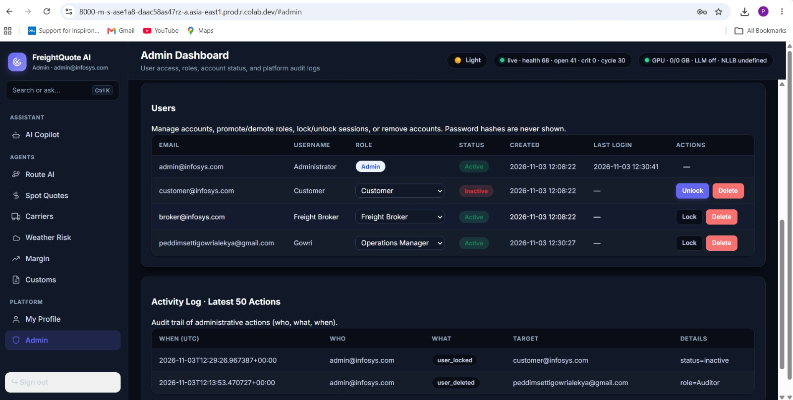
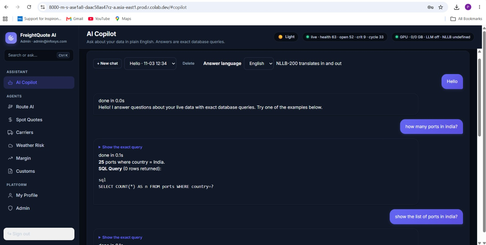

# FreightQuote AI — Milestone 2: Enterprise Multi-User Platform
**Infosys Springboard Internship 7.0 · Batch 4**  
*FastAPI · SQLite · JWT · RBAC · Google Colab · Autonomous AI Agents*

---

## 1. Project Overview

FreightQuote AI is an autonomous maritime logistics and freight pricing intelligence platform built with **FastAPI**, **SQLite**, **PyJWT**, and a single-page reactive dashboard. In Milestone 2, the application transitions from a single local administrator into an enterprise multi-user platform featuring:
* **Unified Milestone 1 Authentication**: Full user lifecycle including registration, secure login, password complexity enforcement, security question recovery, and Gmail SMTP OTP verification.
* **Role-Based Access Control (RBAC)**: Five distinct operational roles (`Admin`, `Operations Manager`, `Freight Broker`, `Auditor`, `Customer`) enforced at both menu routing and API capability layers (`need(ctx, capability)`).
* **Profile Management**: Self-service user profile displaying account credentials, customer affiliation, joined date, and secure username/password updates.
* **Comprehensive Admin Dashboard**: Centralized administration page with user provisioning, promote/demote controls, instant lock/unlock toggles, delete safeguards, and an activity audit log.
* **Fine-Tuned AI Copilot**: Deterministic, SQL-backed conversational assistant supporting 20+ maritime question patterns, typographical normalization, SQL query transparency, and RBAC data scoping without external LLM hallucinations.
* **Modern Maritime Design System**: Dynamic light/dark theme switch, responsive mobile navigation, glassmorphic layout, and interactive maritime cargo ship radar telemetry.

---

## 2. Repository Structure

```text
Milestone2/
├── FreightQuote_Milestone2_C.ipynb   # Main Google Colab Jupyter Notebook
├── README.md                          # Milestone 2 build & operational documentation
└── screenshots/                       # Verification screenshots for project evaluation
    ├── login.jpeg                     # Login portal with interactive maritime radar
    ├── signup.jpeg                    # Sign-up page with role selection & password toggle
    ├── profile.jpeg                   # My Profile view with account overview & security update
    ├── admindashboard.jpeg            # Admin dashboard KPI cards & Add User form
    ├── admindashboard1.jpeg           # Admin users management table & activity audit log
    └── aicopilot.jpeg                 # AI Copilot answering natural language queries via SQL
```

---

## 3. How to Run the Application

### Step 1: Open in Google Colab
1. Download the file FreightQuote_Milestone2.ipynb
2. Select **Runtime** → **Run all** (or press `Ctrl+F9`).

### Step 2: Configure Colab Secrets (Left Sidebar 🔑)
Add the following keys under Colab Secrets for full production authentication and email OTP delivery:
| Secret Name | Purpose | Example / Format |
|---|---|---|
| `JWT_SECRET` | Secret key for signing HS256 authentication JWT tokens | `supersecret-jwt-key-2026` |
| `NGROK_AUTHTOKEN` | *(Optional)* Fallback public URL tunnel if Colab port forwarding is restricted | `2N...your_authtoken` |
| `EMAIL_ID` | Sender Gmail address for 6-digit OTP verification codes | `yourname@gmail.com` |
| `EMAIL_PASSWORD` | 16-character Google App Password (not your personal Gmail password) | `abcd efgh ijkl mnop` |

> *Note: If secrets are omitted, the application generates a secure runtime fallback JWT secret and provides local security-question recovery.*

### Step 3: Access the Portal
When the final notebook cell finishes executing, it prints:
```text
FreightQuote AI is running at: https://8000-m-s-...colab.dev/
```
Click the link to open the live dashboard. If Google Colab port forwarding is blocked by your network, the cell automatically initializes an **ngrok** tunnel.


---

## 4. Role-Based Access Control (RBAC)

The platform implements 5 distinct operational roles defined in `rbac.py` and strictly enforced by `need(ctx, capability)` on every API route and page:

| Role | Operational Scope | Key Privileges |
|---|---|---|
| **Admin** | Platform operator | Full access to all 7 pages, quote creation, storm injection, user provisioning, role promotion, account locking, and audit logs. |
| **Operations Manager** | Logistics & dispatch lead | Access to Route AI, Carriers, Weather Risk, Customs, and Copilot; can trigger agent execution cycles and voyage re-routing; cannot manage users. |
| **Freight Broker** | Commercial pricing lead | Access to AI Copilot, Spot Quotes (create & view), Carriers, and Margin Intelligence; cannot inject storms or edit customs rules. |
| **Auditor** | Compliance & oversight reviewer | Comprehensive read-only access to all operational and financial pages; cannot generate quotes or execute agents. |
| **Customer** | External shipper | Scoped strictly to their own account quotes and shipments (`WHERE customer_id=?`); internal costs, margins, and agent tickets are hidden. |

### Page Access Matrix

| Role | AI Copilot | Route AI | Spot Quotes | Carriers | Weather Risk | Margin | Customs | Run Agents | Users / Admin |
|:---:|:---:|:---:|:---:|:---:|:---:|:---:|:---:|:---:|:---:|
| **Admin** | ✓ | ✓ | ✓ | ✓ | ✓ | ✓ | ✓ | ✓ | ✓ |
| **Operations Manager** | ✓ | ✓ | ✗ | ✓ | ✓ | ✗ | ✓ | ✓ | ✗ |
| **Freight Broker** | ✓ | ✗ | ✓ | ✓ | ✗ | ✓ | ✗ | ✗ | ✗ |
| **Auditor** | ✓ | ✓ | ✓ | ✓ | ✓ | ✓ | ✓ | ✗ | ✗ |
| **Customer** | ✓ | ✗ | ✓ *(own)* | ✗ | ✗ | ✗ | ✗ | ✗ | ✗ |

> **Server-Side Enforcement**: Hiding menu tabs is insufficient for security. Directly requesting a restricted route (e.g. `GET /api/page/admin` or `POST /api/run_agent`) evaluates `need(ctx, capability)` and immediately responds with **HTTP 403 Forbidden**.


---
## Login Page



---
## Signup Page



---
## 5. Profile Page 

Accessible to all authenticated users via the sidebar:
* **Account Overview Card**: Displays account username, email, active role badge, unique Customer ID (`USR-xxxx`), joined timestamp, and last login time.
* **Credential Self-Service**: Allows users to update their display username and update their password.
* **Password Verification Safeguard**: Updating credentials requires verifying the existing password first and enforces Milestone 2 complexity rules on the new password.
* **Security Notice**: Explicitly ensures that passwords and cryptographic hashes are never displayed in the DOM or returned in JSON responses.



---

## 6. Admin Dashboard 

Restricted exclusively to the **Admin** role via `need(ctx, "users")`:
* **KPI Metrics**: Real-time summary cards displaying **Total Users**, **Locked Users**, **Administrators**, and user counts broken down by operational role.
* **Add New User Form**: Dedicated creation form (Email, Username, Temporary Password, Role). "Admin" is omitted from the role selector to prevent accidental privilege escalation.
* **User Management Table**:
  * Displays Email, Username, Role dropdown, Account Status (`Active` or `Inactive`), Created Date, Last Login, and Actions.
  * **Role Promotion / Demotion**: Role changes update dynamically in SQLite and write an entry to the audit log. The primary Administrator cannot be demoted.
  * **Lock / Unlock**: Immediately sets `account_status = 'inactive'` or `'active'`. Locked users have their JWT session invalidated on their very next request.
  * **Delete User**: Protected by confirmation. An Admin cannot delete or lock their own active account, and the last remaining Admin can never be deleted.
* **Activity Audit Log**: Displays the latest 50 administrative actions recorded in the database, including timestamp (UTC), actor, action type, target account, and metadata details.





---

## 7. Fine-Tuned AI Copilot (SQL-Backed)

The AI Copilot operates deterministically through SQL queries without external LLM dependencies, eliminating hallucinations and ensuring zero factual divergence.



### Tested Question Patterns & Execution Table

| # | Question Pattern | Role Access | Executed SQL Query | Sample Output |
|---|---|---|---|---|
| 1 | `"which carrier is cheapest to Rotterdam"` | Admin, Broker, Auditor, Customer | `SELECT s.carrier, ROUND(AVG(q.final_price),2) AS avg_quote_price, COUNT(*) AS quote_count FROM freight_quotes q JOIN shipments s ON s.shipment_id=q.shipment_id WHERE lower(s.dest_port) LIKE ? AND s.carrier IS NOT NULL GROUP BY s.carrier ORDER BY avg_quote_price ASC LIMIT 10` | Lowest average quoted price for **Rotterdam**: **CMA CGM** ($3,600.00 avg). |
| 2 | `"quotes below 10% margin"` | Admin, Broker, Auditor | `SELECT quote_id, shipment_id, carrier, final_price, margin_pct, status FROM freight_quotes WHERE margin_pct < ? ORDER BY margin_pct ASC LIMIT 50` | Found **2** quotes below 10% profit margin. |
| 3 | `"how many shipments are on customs hold"` | Admin, Ops Mgr, Auditor | `SELECT shipment_id, origin_port, dest_port, carrier, status, eta FROM shipments WHERE lower(status) LIKE '%customs%hold%' ORDER BY eta LIMIT 50` | Found **2** shipments currently on customs hold. |
| 4 | `"which ports are most congested"` | Admin, Ops Mgr, Broker, Auditor | `SELECT port_name, country, region, congestion_index, avg_dwell_days FROM ports ORDER BY congestion_index DESC LIMIT 10` | Top **5** congested ports ranked by index (highest: Shanghai, CI 4.2). |
| 5 | `"show storms near the Red Sea"` | Admin, Ops Mgr, Auditor | `SELECT port_name, current_severity, forecast, wind_speed, wave_height FROM weather_risks WHERE lower(port_name) LIKE ? OR lower(forecast) LIKE ? ORDER BY current_severity DESC LIMIT 20` | Weather and storm records matching **Red Sea**: **1** row found. |
| 6 | `"which carrier is most reliable on-time"` | Admin, Ops Mgr, Broker, Auditor | `SELECT name, rating, on_time_pct, avg_cost_index, risk_level FROM carriers ORDER BY on_time_pct DESC LIMIT 10` | Top carriers ranked by on-time delivery. Best: **Maersk Line** (92.5%). |
| 7 | `"which carrier has lowest cost index"` | Admin, Broker, Auditor | `SELECT name, rating, on_time_pct, avg_cost_index, risk_level FROM carriers ORDER BY avg_cost_index ASC LIMIT 10` | Top carriers with lowest cost index. Lowest: **Evergreen** (0.98). |
| 8 | `"how many shipments are delayed"` | Admin, Ops Mgr, Auditor | `SELECT shipment_id, origin_port, dest_port, carrier, status, predicted_delay_risk, eta FROM shipments WHERE lower(status) LIKE '%delay%' OR predicted_delay_risk > 0.6 ORDER BY predicted_delay_risk DESC LIMIT 50` | Found **3** shipments marked delayed or with high delay risk. |
| 9 | `"which shipments are heaviest"` | Admin, Ops Mgr, Auditor | `SELECT shipment_id, origin_port, dest_port, carrier, weight_kg, status FROM shipments ORDER BY weight_kg DESC LIMIT 10` | Top heaviest shipments in transit (Heaviest: **SHP-104**, 42,000 kg). |
| 10 | `"which customers have highest credit risk"` | Admin, Broker, Auditor | `SELECT customer_id, name, industry, priority_tier, credit_risk FROM customers ORDER BY credit_risk DESC LIMIT 10` | Customers ranked by credit risk (Highest: **Vortex Chemicals**, score 0.68). |
| 11 | `"how many quote requests are pending"` | Admin, Broker, Auditor | `SELECT req_id, ts, origin, dest, cargo, weight_t, status FROM quote_requests WHERE lower(status)='pending' OR quote_id IS NULL ORDER BY req_id DESC LIMIT 50` | Found **1** pending quote requests awaiting pricing. |
| 12 | `"what are the most expensive quotes"` | Admin, Broker, Auditor | `SELECT quote_id, shipment_id, customer_id, carrier, final_price, margin_pct, status FROM freight_quotes ORDER BY final_price DESC LIMIT 10` | Top highest priced freight quotes (Highest: **QTE-103**, $5,100.00). |
| 13 | `"which vessels are moving fastest"` | Admin, Ops Mgr, Auditor | `SELECT shipment_id, route_name, lat, lon, progress, speed_kn FROM vessels WHERE speed_kn > 0 ORDER BY speed_kn DESC LIMIT 10` | Fastest active vessels underway (Fastest: **SHP-104**, 21.0 knots). |
| 14 | `"what are the highest customs duties"` | Admin, Ops Mgr, Auditor | `SELECT chapter, goods, duty_pct, docs, restricted FROM customs_rules ORDER BY duty_pct DESC LIMIT 20` | Tariff rates across commodities (Highest: **Organic chemicals**, 12.0%). |
| 15 | `"show critical agent alerts"` | Admin, Ops Mgr, Auditor | `SELECT action_id, ts, type, target, severity, status, owner, detail FROM agent_actions WHERE status IN ('open', 'proposed') ORDER BY CASE severity WHEN 'Critical' THEN 0 WHEN 'Warning' THEN 1 ELSE 2 END, action_id DESC LIMIT 20` | Found **2** active agent action tickets. |
| 16 | `"how many shipments per carrier"` | Admin, Ops Mgr, Broker, Auditor | `SELECT carrier, COUNT(*) AS shipment_count, ROUND(AVG(weight_kg), 1) AS avg_weight_kg FROM shipments WHERE carrier IS NOT NULL GROUP BY carrier ORDER BY shipment_count DESC` | Shipment distribution across carriers. |
| 17 | `"which origin ports have most shipments"` | Admin, Ops Mgr, Broker, Auditor | `SELECT origin_port, COUNT(*) AS departure_count FROM shipments GROUP BY origin_port ORDER BY departure_count DESC LIMIT 10` | Top origin departure ports by volume. |
| 18 | `"which carrier gives highest margin"` | Admin, Broker, Auditor | `SELECT carrier, ROUND(AVG(margin_pct), 2) AS avg_margin_pct, COUNT(*) AS quote_count FROM freight_quotes WHERE carrier IS NOT NULL GROUP BY carrier ORDER BY avg_margin_pct DESC LIMIT 10` | Average profit margin by carrier across all quotes. |
| 19 | `"show shipments by Maersk"` | Admin, Ops Mgr, Broker, Auditor | `SELECT shipment_id, origin_port, dest_port, carrier, status, eta FROM shipments WHERE lower(carrier) LIKE ? ORDER BY eta LIMIT 50` | Found **1** shipments assigned to **Maersk**. |
| 20 | `"which ports have longest dwell times"` | Admin, Ops Mgr, Broker, Auditor | `SELECT port_name, country, region, avg_dwell_days, congestion_index FROM ports ORDER BY avg_dwell_days DESC LIMIT 10` | Top ports by average dwell days (Longest: Shanghai Port, 5.1 days). |

### Typographical & Wording Resilience
Questions pass through `_normalise_question()` to resolve misspellings and conversational variations before matching:
* **Port Typo Correction**: `rotterdm`, `singapor`, `shanghi` → `rotterdam`, `singapore`, `shanghai`.
* **Carrier Typo Correction**: `maerskk`, `hapagg`, `evergren` → `maersk`, `hapag-lloyd`, `evergreen`.
* **Operational Keyword Mapping**: `cheepest` → `cheapest`, `conjestion` → `congestion`, `custons` → `customs`, `stoms` → `storms`.
* **Polite Out-of-Scope Fallback**: For questions outside the maritime operational database, Copilot responds politely and provides three valid suggested prompts.

---

## 8. Team Roles & Responsibilities

| Team Member | Module / Domain | Key Responsibilities & Delivered Features |
|---|---|---|
| **Gowri Alekya Peddimsetti** | **UI & Login** | • Milestone 1 authentication integration (Signup, Signin, Password Recovery via Security Question & Email OTP)<br>• Design system overhaul (CSS variables, light/dark mode switch, mobile responsive layout & hamburger toggle)<br>• Animated maritime glassmorphic portal, interactive cargo ship radar SVG icon with sonar ping wave<br>• Add roles in signup page |
| **Smruti Ranjan Das** | **Dashboard** | • Dedicated Admin Dashboard (`#admin`) restricted exclusively to Admin role via `need(ctx, "users")`<br>• Real-time KPI summary cards (Total Users, Locked/Inactive Users, Administrators, Users by Role)<br>• User management table with dynamic status badges, role promote/demote dropdown, instant lock/unlock toggles, and safe deletion confirmation<br>• Activity audit log table displaying the latest 50 administrative events (who, what, when, target, details)<br>• User Profile page (`#profile`) with metadata overview and current-password verified credential updates |
| **Harika Gollapelli** | **Roles & RBAC** | • 5-tier Role-Based Access Control architecture (`Admin`, `Operations Manager`, `Freight Broker`, `Auditor`, `Customer`) in `rbac.py`<br>• Server-side capability-based authorization (`ROLE_CAPS`, `ROLE_MENU`) with `need(ctx, capability)` raising HTTP 403 Forbidden<br>• Page Access Matrix enforcement preventing direct URL bypass (`/api/page/{id}`)<br>• Customer data isolation scoping quotes and shipments by `customer_id`<br>• Role hierarchy rules (preventing self-locking/self-deletion, protecting the last Admin, and restricting Admin assignment during user creation) |
| **Sneha Tripathi** | **AI Copilot** | • Fine-tuned conversational query engine in `analyst.py` and `qa.py` with 20+ maritime freight question patterns<br>• 100% deterministic SQL-backed execution ensuring zero hallucination without external LLM dependencies<br>• Typo and wording normalization engine (`_normalise_question`) correcting port names, carrier codes, and operational jargon<br>• Full query transparency displaying executed SQL statements and returned row counts<br>• Polite out-of-scope fallback responses with 3 role-appropriate suggestions and strict RBAC data filtering |

---

### Collaborators
* Gowri Alekya Peddimsetti
* Harika Gollapelli
* Smruti Ranjan Das
* Sneha Tripathi
